# Mermaid 基本文法ガイド

本ドキュメントは、DocBaseのヘルプ記事（[Mermaid (マーメイド) 記法と書き方](https://help.docbase.io/posts/3719897)）をベースに、Mermaidの基本的な文法から各種ダイアグラムの書き方、実践例、トラブルシューティングまでをまとめたリファレンスです。

---

## 目次
1. [Mermaidとは](#1-mermaidとは)
2. [Mermaidを使うメリット](#2-mermaidを使うメリット)
3. [基本構文とコードブロックの書き方](#3-基本構文とコードブロックの書き方)
4. [フローチャート (Flowchart)](#4-フローチャート-flowchart)
5. [シーケンス図 (Sequence Diagram)](#5-シーケンス図-sequence-diagram)
6. [クラス図 (Class Diagram)](#6-クラス図-class-diagram)
7. [状態図 (State Diagram)](#7-状態図-state-diagram)
8. [ER図 (Entity-Relationship Diagram)](#8-er図-entity-relationship-diagram)
9. [ガントチャート (Gantt Chart)](#9-ガントチャート-gantt-chart)
10. [ジャーニーチャート (User Journey)](#10-ジャーニーチャート-user-journey)
11. [Gitグラフ (Git Graph)](#11-gitグラフ-git-graph)
12. [円グラフ (Pie Chart)](#12-円グラフ-pie-chart)
13. [要件図 (Requirement Diagram)](#13-要件図-requirement-diagram)
14. [C4モデル (C4 Context Diagram)](#14-c4モデル-c4-context-diagram)
15. [アーキテクチャダイアグラム (Architecture Diagram)](#15-アーキテクチャダイアグラム-architecture-diagram)
16. [実践的なユースケース](#16-実践的なユースケース)
17. [よくあるエラーと解決方法](#17-よくあるエラーと解決方法)

---

## 1. Mermaidとは

**Mermaid（マーメイド）** は、シンプルなテキストベースの記法を用いて様々な図表をレンダリングできるJavaScriptベースのツールです。  
Markdown風のテキストで記述できるため、作図ツールのバイナリファイルや画像ファイルと異なり、**Git等のバージョン管理システムと非常に高い親和性**を持ちます。

---

## 2. Mermaidを使うメリット

- **文書と図表の一体管理**: Markdown文書の中にコードとして図を埋め込めるため、設計書と図の乖離が起きにくい。
- **チーム編集が容易**: 専用ツールのインストールや有料ライセンスが不要で、誰でもテキストエディタで修正可能。
- **変更差分（diff）の可視化**: Gitで「どこがどう修正されたか」を行単位で追跡・レビュー可能。
- **検索性の向上**: 図の中の文言がテキストデータであるため、全文検索にヒットする。

---

## 3. 基本構文とコードブロックの書き方

Markdownファイル内でコードブロックの言語指定に `mermaid` を記述します。

````markdown
```mermaid
[図の種類] [オプション]
    要素1 関係 要素2
```
````

### 最小の例
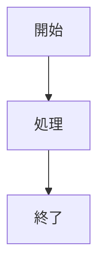

---

## 4. フローチャート (Flowchart)

プロセスやワークフローの流れを視覚化します。

### 4.1 基本例
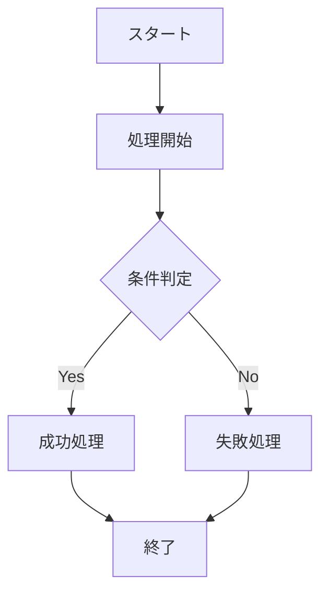

### 4.2 方向の指定
グラフの先頭で描画の向きを指定します。
- `TD` / `TB`: 上から下 (Top to Down / Top to Bottom)
- `BT`: 下から上 (Bottom to Top)
- `LR`: 左から右 (Left to Right)
- `RL`: 右から左 (Right to Left)

### 4.3 ノードの形状
| 記述例 | 形状 | 用途 |
|---|---|---|
| `[テキスト]` | 四角形 | 一般的な処理 |
| `(テキスト)` | 角丸四角形 | 処理・ステップ |
| `([テキスト])` | 楕円 / スタジアム型 | 開始 / 終了 |
| `[[テキスト]]` | サブルーチン | 別定義の処理呼び出し |
| `[(テキスト)]` | 円柱（データベース） | DB / ストレージ |
| `((テキスト))` | 円 | 結合点・イベント |
| `{テキスト}` | ひし形 | 条件分岐・判断 |

### 4.4 矢印・線の種類
- `-->` : 実線矢印
- `---` : 実線（矢印なし）
- `==>` : 太線矢印
- `-.->` : 点線矢印
- `--o` : 先端が丸
- `--x` : 先端がバツ
- `-- テキスト -->` または `-->|テキスト|` : ラベル付き矢印

### 4.5 サブグラフ（グループ化）
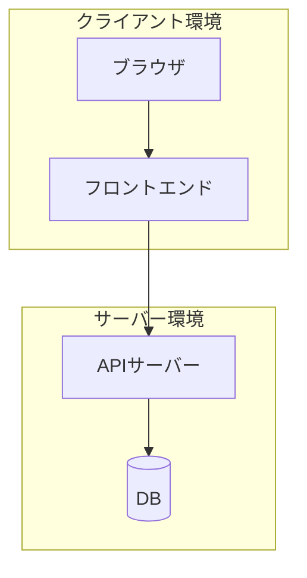

---

## 5. シーケンス図 (Sequence Diagram)

システム間やオブジェクト間のメッセージのやり取りを時系列で表現します。

### 5.1 基本例
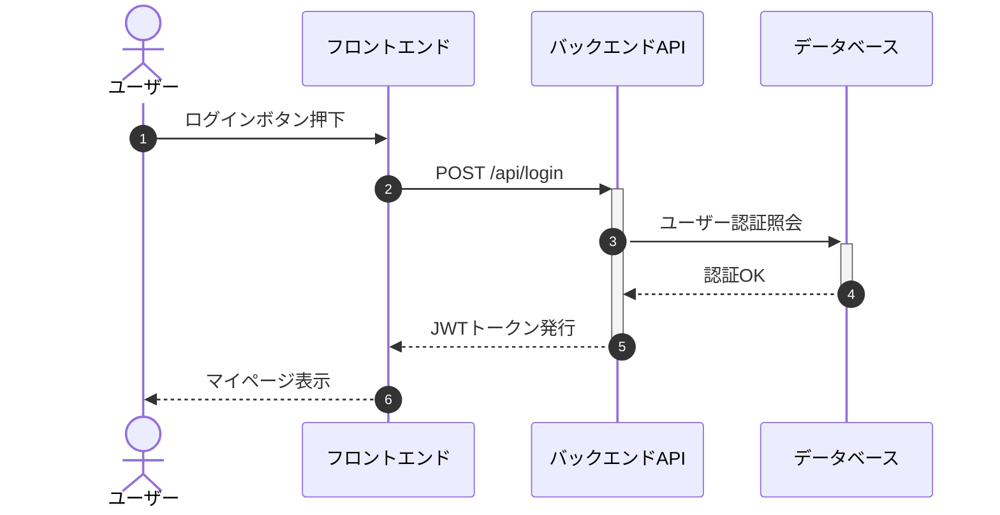

### 5.2 記号と機能
- `participant 名前 as 表示名`: 参加者の定義
- `actor 名前 as 表示名`: 人型アイコンでの表示
- `->>` : 実線矢印（同期呼び出し）
- `-->>` : 破線矢印（戻り値・レスポンス）
- `+` / `-` : アクティベーション（処理実行中バー）の開始・終了（例: `A->>+B: 処理`）
- `Note over A,B: メモ`: ノートの挿入
- `alt ... else ... end`: 条件分岐
- `loop ... end`: 繰り返し
- `par ... and ... end`: 並列処理

---

## 6. クラス図 (Class Diagram)

オブジェクト指向設計におけるクラスの構造や関係性を表現します。

### 6.1 基本例
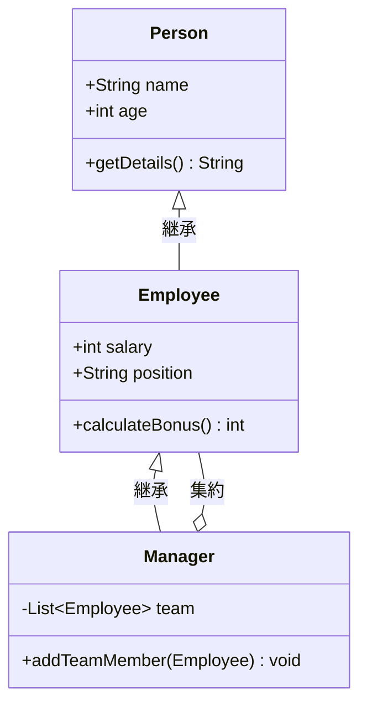

### 6.2 可視性（アクセス修飾子）
- `+` : public
- `-` : private
- `#` : protected
- `~` : package / internal

### 6.3 クラス間の関係
| 記号 | 関係 | 意味 |
|---|---|---|
| `<\|--` | 継承 (Inheritance) | 親クラスから子クラスへの継承 |
| `*--` | コンポジション (Composition) | 強い所有（全体が消えれば部分も消える） |
| `o--` | 集約 (Aggregation) | 弱い所有（全体と部分が独立可能） |
| `-->` | 関連 (Association) | クラス間の一般的な参照関係 |
| `..\|>` | 実装 (Realization) | インターフェースの実装 |
| `..>` | 依存 (Dependency) | 一時的な利用などの依存 |

---

## 7. 状態図 (State Diagram)

オブジェクトやシステムの状態遷移を表現します。

### 7.1 基本例
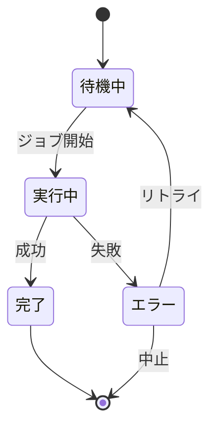

### 7.2 ネスト（複合状態）
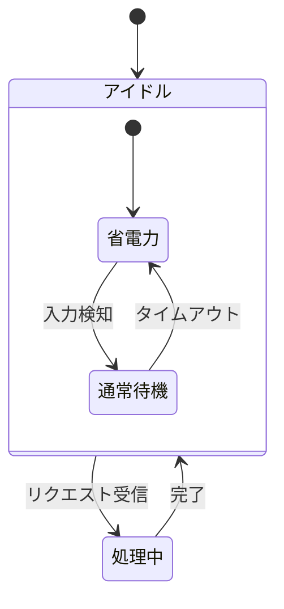

---

## 8. ER図 (Entity-Relationship Diagram)

リレーショナルデータベースのテーブル設計・エンティティ間リレーションを表現します。

### 8.1 基本例
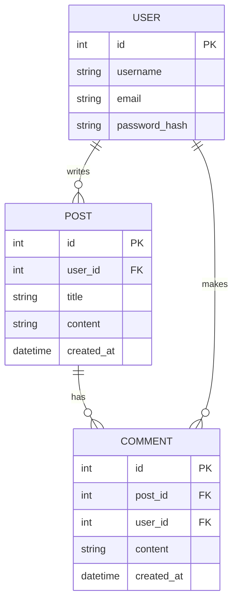

### 8.2 カーディナリティ（多重度）の記法
| 記法 | 意味 |
|---|---|
| `\|\|--\|\|` | 1 対 1（必須 対 必須） |
| `\|\|--o{` | 1 対 多（必須 対 0以上） |
| `\|\|--\|{` | 1 対 多（必須 対 1以上） |
| `}\|--\|{` | 多 対 多（1以上 対 1以上） |
| `}|..|{` | 多 対 多（0以上 対 0以上、破線） |

---

## 9. ガントチャート (Gantt Chart)

プロジェクトのスケジュールやタスク依存関係を可視化します。

### 9.1 基本例
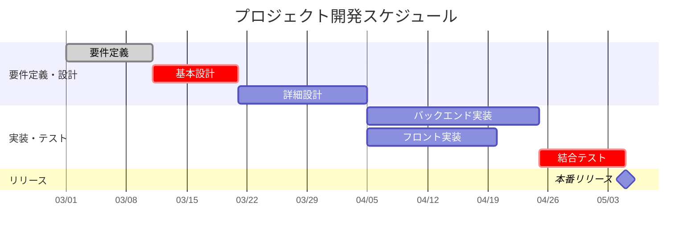

### 9.2 タスクの修飾子
- `done`: 完了済みタスク
- `active`: 進行中タスク
- `crit`: クリティカルパス（重要タスク）
- `milestone`: マイルストーン（期間0の日程）
- `after タスクID`: 指定タスク完了後に開始

---

## 10. ジャーニーチャート (User Journey)

ユーザーの行動ステップと感情・満足度スコア（1〜5）を可視化します。

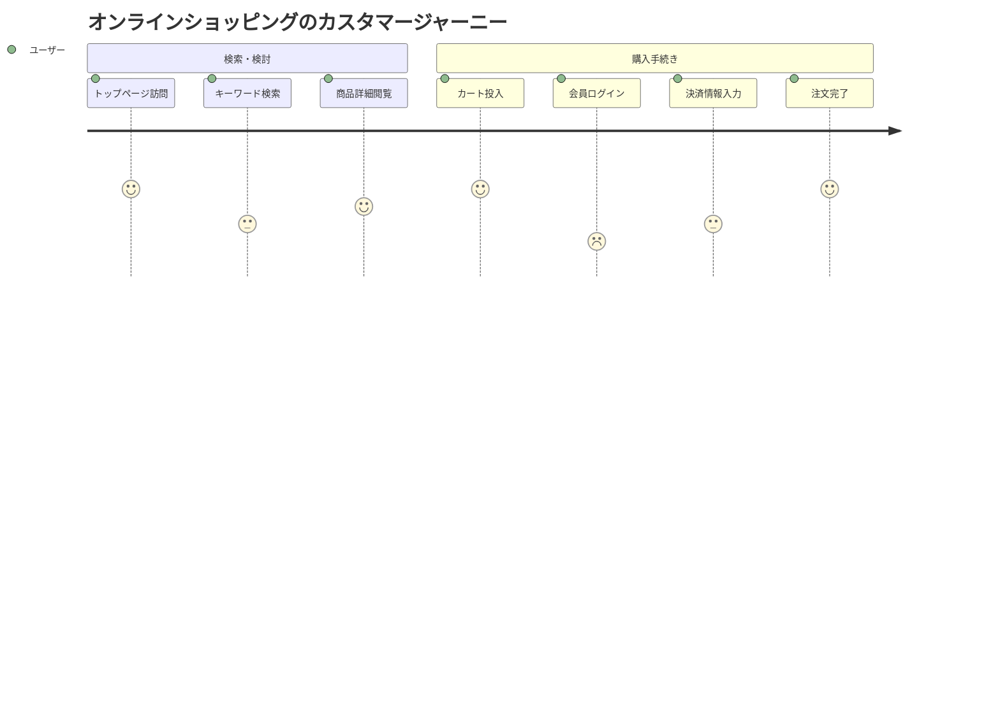

---

## 11. Gitグラフ (Git Graph)

ブランチの派生やマージ履歴を視覚化します。

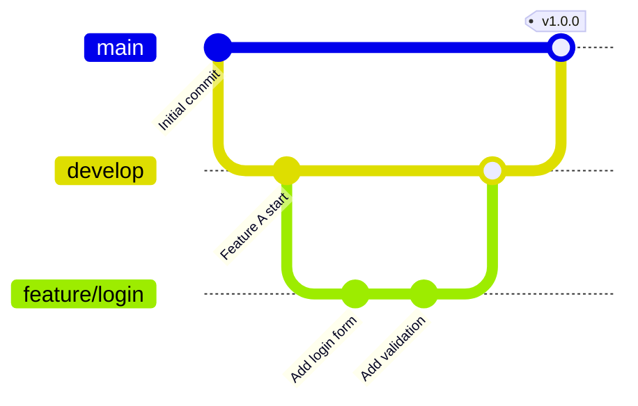

---

## 12. 円グラフ (Pie Chart)

データの比率をシンプルな円グラフで表示します。

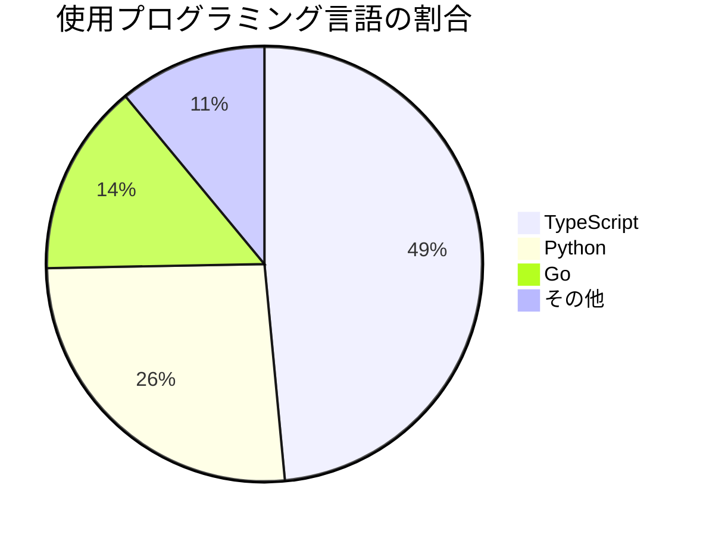

---

## 13. 要件図 (Requirement Diagram)

システム要件の定義と検証・関連要素との紐付けを記述します。

```mermaid
requirementDiagram

    requirement user_auth {
        id: REQ-001
        text: "多要素認証（MFA）をサポートすること"
        risk: high
        verifymethod: test
    }

    element auth_service {
        type: service
    }

    auth_service - satisfies -> user_auth
```

---

## 14. C4モデル (C4 Context Diagram)

ソフトウェアアーキテクチャのコンテキストを可視化します。

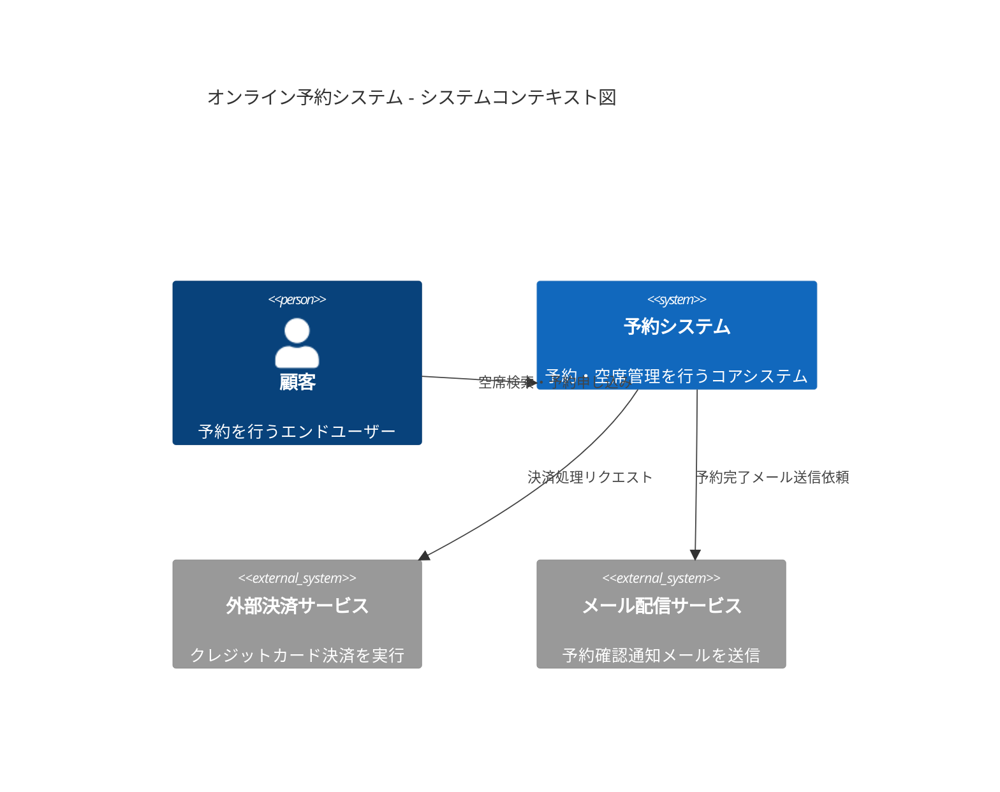

---

## 15. アーキテクチャダイアグラム (Architecture Diagram)

クラウドインフラやマイクロサービスのコンポーネント配置・接続関係を表現する構文です（`architecture-beta`）。

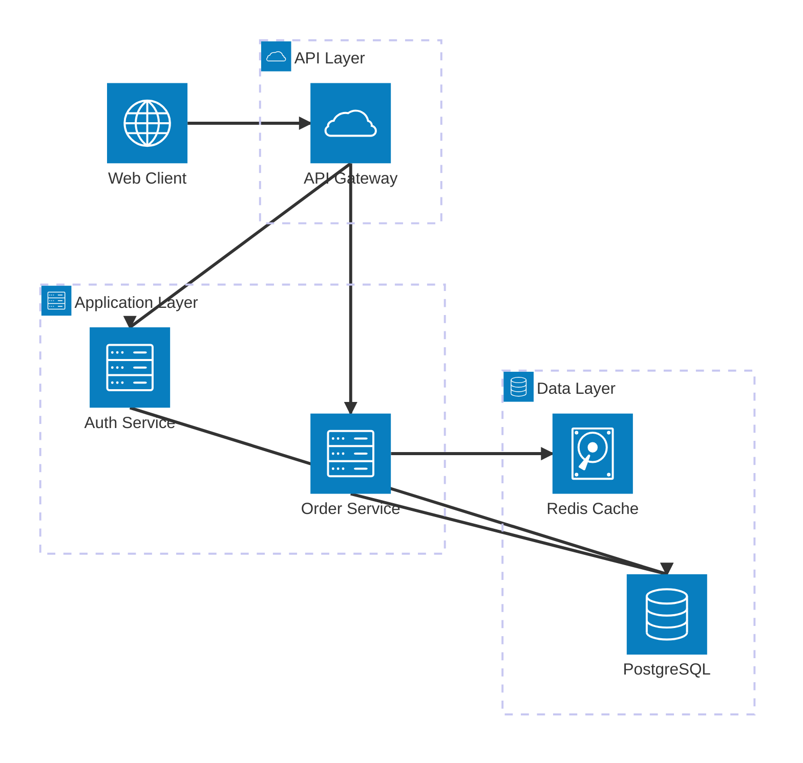

- 方向指定: `T` (上), `B` (下), `L` (左), `R` (右)
- デフォルト利用可能アイコン: `cloud`, `database`, `disk`, `internet`, `server`

---

## 16. 実践的なユースケース

### 16.1 業務フロー（左右配置: graph LR）
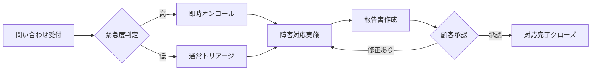

### 16.2 例外・エラーハンドリングを含むAPI連携シーケンス
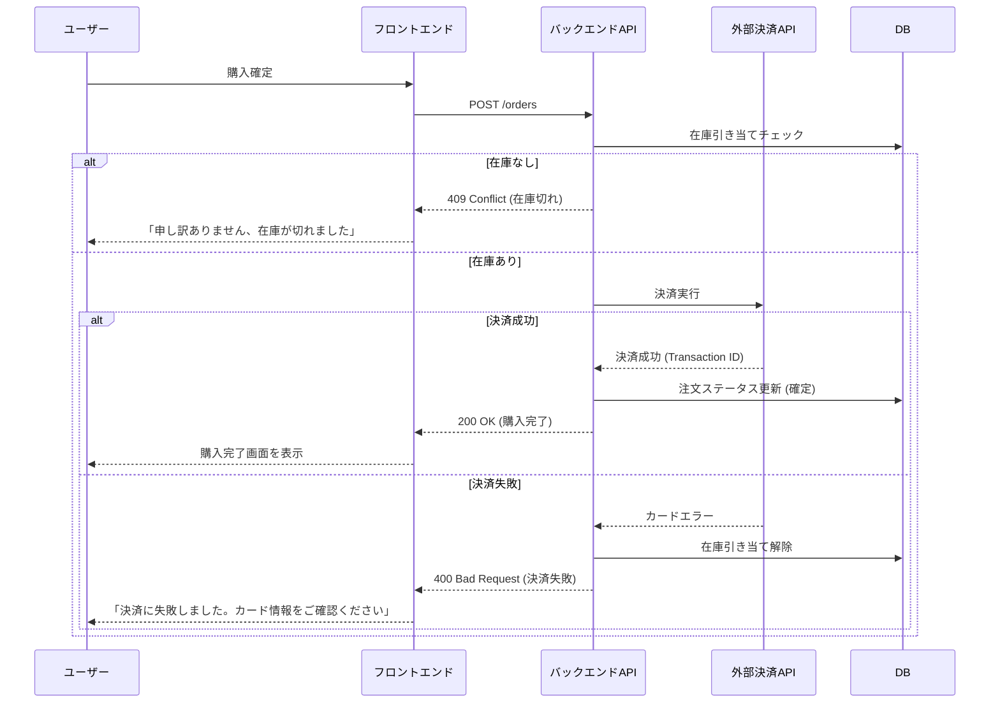

---

## 17. よくあるエラーと解決方法

### 17.1 構文エラー（レンダリングされない）
- **バッククォートの確認**: 開始 ` ```mermaid ` と終了 ` ``` ` が正しく対になっているか確認します。
- **予約語・記号のコンフリクト**: ラベル内に `( )`, `[ ]`, `{ }` などの括弧やダブルクォートが含まれる場合は、ダブルクォートで文字列全体を囲みます。
  - 例: `A["処理(オプション)"] --> B`
- **コロンやセミコロン**: 各ダイアグラムの構文規則（セミコロンの要否など）を確認します。

### 17.2 日本語・特殊文字の文字化けやエラー
- ファイルの文字コードが **UTF-8** で保存されていることを確認します。
- 比較演算子 `<` や `>` をラベルで使う場合は、`&lt;` や `&gt;` とHTML実体参照にエスケープするか、クォートで囲みます。

### 17.3 矢印の方向が崩れる・複雑で見づらい場合
- グラフ全体の向き（`TD` と `LR`）を切り替えてみる。
- 関連するノードを `subgraph` でグループ化する。
- 1つの図に詰め込みすぎず、**概要図** と **各機能の詳細図** に分割する。

---

## 参考リンク
- [Mermaid 公式サイト](https://mermaid.js.org/)
- [Mermaid Live Editor（ブラウザでリアルタイム編集）](https://mermaid.live/)
- [DocBase 公式ヘルプ: Mermaid (マーメイド) 記法と書き方](https://help.docbase.io/posts/3719897)
